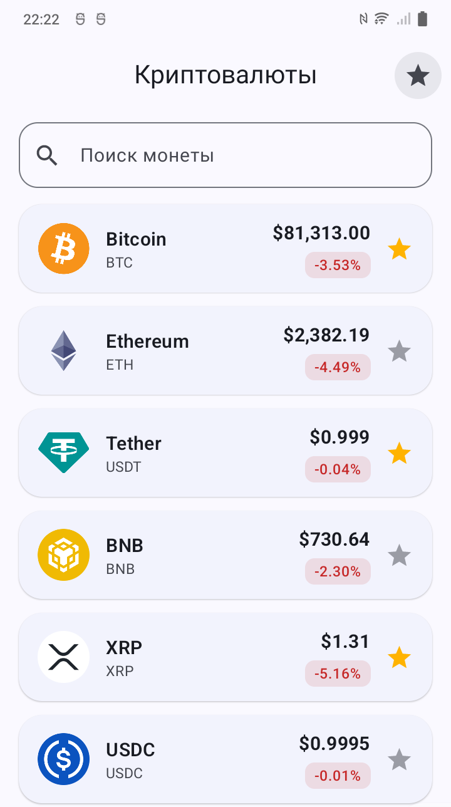
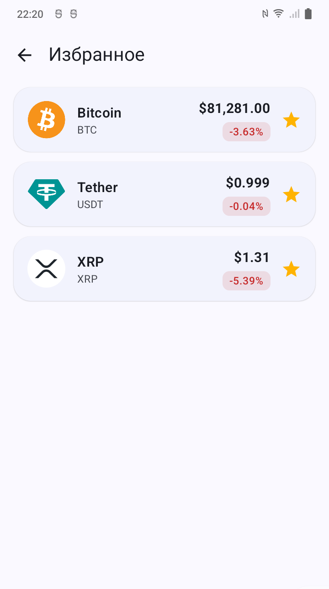
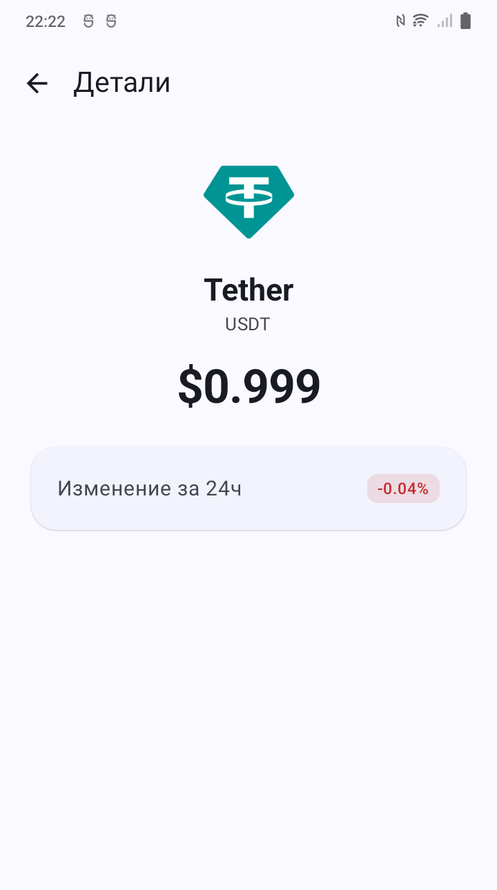

# CryptoTracker

Трекер цен на криптовалюты для Android: список монет с ценой и изменением за 24 часа, поиск, избранное и экран деталей. Данные кэшируются, поэтому список открывается и без сети. Проект написан, чтобы отработать современную Android-архитектуру целиком: UI на Jetpack Compose, MVVM с разделением на слои data/domain/ui, корутины + Flow, Room, DataStore и работа с реальным REST API.

## Возможности

- Список криптовалют с актуальной ценой и изменением за 24ч (зелёный — рост, красный — падение)
- Поиск по названию и тикеру
- Избранное: звезда у монеты, отдельный экран, список хранится в DataStore
- Офлайн-кэш в Room: без сети показываются последние загруженные данные
- Экран деталей по тапу на монету
- Состояния загрузки и ошибки с кнопкой **«Повторить»**; повторный тап во время загрузки не запускает вторую
- Данные из публичного API [CoinGecko](https://www.coingecko.com/en/api)

## Скриншоты

&nbsp;&nbsp;&nbsp;&nbsp;

## Стек

| Область | Инструменты |
|---------|-------------|
| Язык | Kotlin |
| UI | Jetpack Compose, Material 3 |
| Архитектура | MVVM, однонаправленный поток данных (UDF) |
| DI | Hilt (Dagger) |
| Асинхронность | Coroutines, Flow, StateFlow |
| Сеть | Retrofit, Gson |
| Хранение | Room (кэш монет), DataStore (избранное) |
| Изображения | Coil (иконки монет) |
| Навигация | Navigation-Compose |
| Тестирование | JUnit, coroutines-test (фейки, MainDispatcherRule) |
| CI | GitHub Actions: сборка и unit-тесты на каждый пуш |

## Архитектура

Разделение на три слоя, зависимости направлены внутрь (`ui → domain ← data`):

| Слой | Содержимое | Зависит от |
|------|-----------|-----------|
| **ui** | Compose-экраны, ViewModel, `StateFlow<UiState>` | domain |
| **domain** | модель `Coin`, интерфейсы репозиториев | — |
| **data** | Retrofit `CoinApi`, Room `CoinDao`, DataStore, мапперы, реализации репозиториев | domain |

`ui` наблюдает состояние и шлёт события во `ViewModel`. `domain` не имеет зависимостей. `data` реализует репозитории и обращается к **CoinGecko REST API** и к локальной базе.

**Поток данных:** UI собирает `StateFlow<UiState>` из ViewModel и отрисовывает его; действия пользователя вызывают методы ViewModel; ViewModel запрашивает репозиторий. Репозиторий сначала идёт в сеть, мапит DTO в доменные модели и обновляет кэш в Room (в одной транзакции); при ошибке сети отдаёт последние данные из кэша, а если кэша нет — пробрасывает ошибку наверх.

- **data** — `CoinApi`, `CoinDto`, `CoinDao` / `CoinEntity` / `CoinDatabase`, `FavoritesDataStore`, мапперы, `CoinRepositoryImpl`
- **domain** — `Coin`, `CoinRepository`, `FavoritesRepository`
- **ui** — `coinlist`, `detail`, `favorites` (экран + ViewModel + состояние), общие компоненты, `MainActivity` (NavHost)
- **di** — Hilt-модули: `NetworkModule`, `DatabaseModule` (`@Provides`), `RepositoryModule` (`@Binds` интерфейса на реализацию)

**Внедрение зависимостей:** через Hilt. Зависимости идут через интерфейсы, что развязывает слои и упрощает тестирование. Базу пересоздаёт `fallbackToDestructiveMigration`: это только кэш с сервера, терять там нечего.

## Тестирование

Юнит-тесты выполняются на JVM (устройство не нужно), вместо сети и базы — фейки:

- **Мапперы** — DTO → доменная модель по каждому полю
- **Репозиторий** — сеть, кэш без сети, ошибка сервера
- **ViewModel списка** — загрузка, ошибки, retry (в том числе повторный тап во время загрузки), поиск по названию и тикеру, избранное
- **ViewModel деталей** — монета из кэша и «не найдено»
- **Форматирование** — цены и изменение, в том числе прочерк вместо неизвестной цены

## Запуск

1. Клонируй репозиторий и открой в Android Studio.
2. Запусти на эмуляторе или устройстве (min SDK 24).

API публичный, ключ не нужен.
